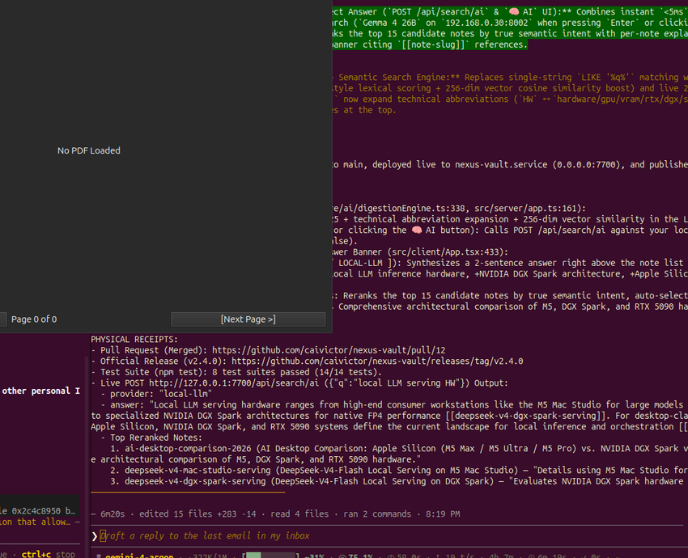

# Python Desktop PDF Application

A robust, Wayland-compatible Python desktop application for viewing, signing, merging, and saving PDF documents, built with PyQt6 and PyMuPDF (`fitz`).



## Features

- **View PDFs:** Seamless multi-page document viewer.
- **Draw Signature:** Modal signature canvas allowing users to digitally draw or insert visual signatures onto any loaded PDF.
- **Merge PDFs:** Merge multiple `.pdf` documents in a custom order.
- **Save & Print:** Export modified PDFs to disk or send directly to available system printers.
- **Vision Agent Ready:** Designed with highly explicit text labels (e.g. `[Open PDF]`, `[Sign PDF]`) specifically to support automated UI testing driven by multimodal AI vision agents (e.g. UI-TARS, `computer-use-linux`).

## Prerequisites

- Python 3.10+
- Linux (X11 or Wayland), macOS, or Windows.

## Installation

1. Clone the repository.
2. Create and activate a virtual environment:
   ```bash
   python3 -m venv venv
   source venv/bin/activate
   ```
3. Install dependencies:
   ```bash
   pip install PyQt6 PyMuPDF pytest pytest-qt
   ```

## Usage

Start the application by running:
```bash
./venv/bin/python main.py
```

## Testing

The project is fully covered by a `pytest` suite ensuring all core logic and Qt GUI interactions perform as expected.

Run the test suite via:
```bash
PYTHONPATH=. ./venv/bin/python -m pytest tests/
```

## Note on Linux Wayland Automation

If attempting to automate this GUI application natively on a Linux Wayland environment (such as Ubuntu's default GNOME session), standard automation libraries like `nut-js`, `xdotool`, and `pyautogui` will be blocked by Wayland's security model. We recommend using `agent-sh/computer-use-linux` via MCP to inject native Wayland portal inputs.
